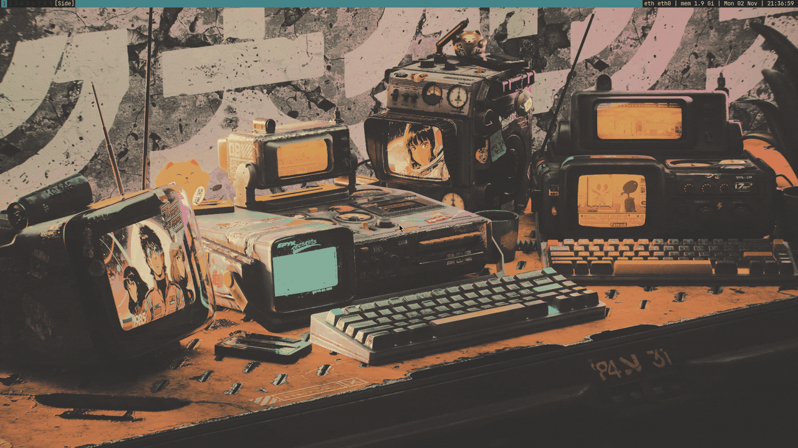

# PenroseWM
My window manager, built with the [Penrose](https://github.com/sminez/penrose) library. The bar, borders and menus use [gruvbox](https://github.com/morhetz/gruvbox) dark.



## Install

[PARBS](https://github.com/tcvscheppingen/PARBS) installs penrose together with the rest of the desktop (st, dmenu, slock, dwmblocks, dunst and the dotfiles the key bindings below use), on Arch, Fedora and Artix:

```bash
git clone https://github.com/tcvscheppingen/PARBS
cd PARBS
./auto-rice.sh        # on Artix: ./auto-rice-artix.sh
```

To build only penrose, you need Rust 1.85 or newer and the Xlib, Xft and Xrandr development files:

```bash
cargo build --release
sudo install -Dm755 target/release/penrose_config /usr/local/bin/penrose
```

## Key bindings

`M` is the Super key.

| Keys | Action |
|---|---|
| `M + Return` / `M + d` | Terminal (st) / run a program (dmenu) |
| `M + shift + d` | Open `passmenu` password manager (requires setup) |
| `M + w` / `M + r` | Browser (LibreWolf) / file manager (Thunar) |
| `M + q` | Close the window |
| `M + j/k` / `M + shift + j/k` | Focus / move the window down or up the stack |
| `M + Up/Down` | More or fewer main windows |
| `M + h/l` | Main area smaller or larger |
| `M + shift + f` | Make window fullscreen |
| `M + grave` / `M + shift + grave` | Next / previous layout |
| `M + 1…9` / `M + shift + 1…9` | Go to a workspace / move the window to it |
| `M + Tab` | Previous workspace |
| `M + bracketleft/bracketright` | Focus the previous / next display |
| `M + Backspace` | System menu: lock, leave penrose, sleep, reboot, shutdown (`sysact`) |
| `M + F3` | Display arrangement (`displayselect`) |
| Volume keys / `M + equal/minus` | Volume up or down by 5% |
| Brightness keys | Screen brightness up or down by 5% |
| `M + shift n/m` | Turn redshift blue filter on or off (not installed by default) |
| `M + shift + s` | Write the window manager state to the log |
| `M + alt + Escape` | Exit penrose |

`maimpick` (screenshots) and `dmenurecord` (recordings) come with PARBS, without a key: run them from dmenu, or bind them in `src/main.rs`.

## Changing penrose

- Edit `src/main.rs` (with PARBS: `~/.local/src/penrose/src/main.rs`), then run `cargo build --release` there and `sudo install -m755 target/release/penrose_config /usr/local/bin/penrose`. Leave penrose with `sysact` and log in again to use the new build.
- **Key bindings:** penrose looks up key names with `xmodmap -pke`. Run `cargo test` in a terminal inside X to check them; outside X every key name is unknown.
- **Status bar:** the bar shows the workspaces, the layout, the window title and, on the right, the root window name that dwmblocks sets. There is no system tray.
- **Log:** penrose writes to `~/.local/share/penrose.log`. Look there when it doesn't start.

## Palette

[gruvbox](https://github.com/morhetz/gruvbox) dark:

| | Color | |
|---|---|---|
| Background | `#282828` | Bar |
| Grey | `#3c3836` | Workspaces without windows |
| Text | `#ebdbb2` | Bar text |
| Accent | `#458588` | Focused workspace |

The colors are at the top of `src/main.rs`. PARBS uses the same ones for the rest of the desktop.

## Credits
- [Penrose](https://github.com/sminez/penrose) by sminez
- [gruvbox](https://github.com/morhetz/gruvbox) by Pavel Pertsev
